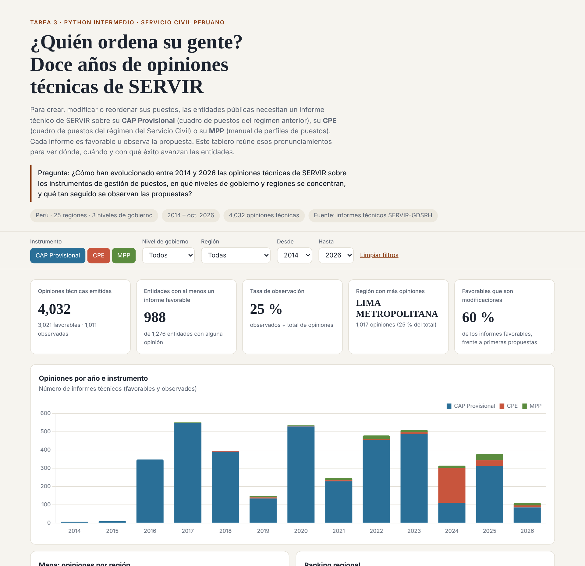
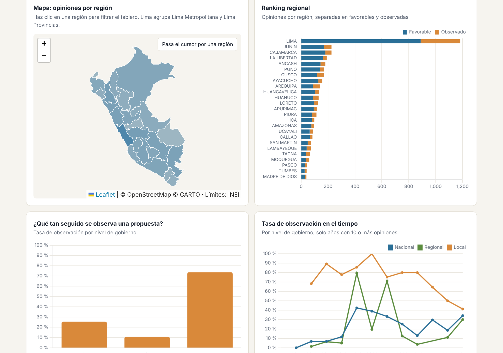

# ¿Quién ordena su gente? Doce años de opiniones técnicas de SERVIR

**Tarea 3 · Python Intermedio (Diplomado Q-LAB, PUCP) · Fiorella Becerril Mercado**

**Tema:** Gestión de puestos en el Estado peruano. Opiniones técnicas de SERVIR sobre el CAP Provisional, el Cuadro de Puestos de la Entidad (CPE) y el Manual de Perfiles de Puestos (MPP), 2014–2026.

**Pregunta de investigación:** ¿Cómo han evolucionado entre 2014 y 2026 las opiniones técnicas de SERVIR sobre los instrumentos de gestión de puestos, en qué niveles de gobierno y regiones se concentran, y qué tan seguido se observan las propuestas?

- **Dashboard público:** https://rociobecerril.github.io/intermedio-2026/tarea_3/web/
- **Reel:** [`reel/reel.mp4`](reel/reel.mp4)
- **Publicación de LinkedIn:** _(agregar enlace)_




## Descripción

Para crear, modificar o reordenar sus puestos, toda entidad pública necesita un informe técnico de SERVIR. El informe puede tratar sobre el **CAP Provisional** (cuadro de puestos de los regímenes 276 y 728, pensado como transitorio), el **CPE** (cuadro de puestos del régimen de la Ley N.° 30057) o el **MPP**. Cada informe es **favorable** u **observa** la propuesta. El proyecto reúne 4,032 de esos pronunciamientos y los presenta en un tablero interactivo con KPIs, serie anual, mapa por región, ranking regional, tasas de observación y un buscador de entidades. El tablero tiene filtros por instrumento, nivel de gobierno, región y rango de años.

**Cobertura:** Perú, 25 regiones y 3 niveles de gobierno. Agosto de 2014 a octubre de 2026.

## Tres hallazgos

1. **El CAP "provisional" se volvió permanente.** El 90 % de las opiniones (3,649 de 4,032) son sobre el CAP Provisional. De sus 2,714 informes favorables, 1,754 (65 %) aprueban una modificación y no un primer cuadro, y 339 entidades acumulan tres o más CAP Provisional favorables.
2. **Las municipalidades son las más observadas, aunque la brecha se cierra.** El 74 % de las propuestas de gobiernos locales recibió observaciones, frente al 25 % de las entidades nacionales y el 11 % de las regionales. La tasa local estuvo cerca de 80 % entre 2017 y 2023 y bajó a 50 % en 2025 y a 41 % en 2026 (51 opiniones).
3. **El tránsito al Servicio Civil llega tarde y de golpe.** De las 258 opiniones sobre CPE, 190 (74 %) se emitieron en 2024. A octubre de 2026, 167 entidades tienen un CPE favorable, frente a 966 con CAP Provisional favorable.

## Fuentes y metodología

| Fuente | Uso |
|---|---|
| Informes técnicos de SERVIR (GDSRH/DDSRH), consolidados en la matriz de seguimiento de la Dirección. Los informes y oficios son documentos públicos ([gob.pe/servir](https://www.gob.pe/servir)). | Base principal: instrumento, año, entidad, nivel, región, tipo de opinión, número de informe |
| Maestro de entidades públicas con ubigeo INEI y coordenadas | Ubicar cada entidad en el mapa |
| Límites departamentales INEI ([peru-geojson](https://github.com/juaneladio/peru-geojson)) | Mapa coroplético |
| Ley N.° 30057 y Directiva N.° 006-2021-SERVIR-GDSRH | Marco normativo de los instrumentos |

**Procesamiento** (`scripts/`):

1. `obtener_datos.py` extrae de la matriz interna solo los campos públicos de cada informe y del maestro de entidades. No exporta nombres de personal, comentarios internos ni registros de asistencia técnica.
2. `procesar_datos.py` hace lo siguiente:
   - Conserva CAP Provisional, CPE y MPP con opinión FAVORABLE u OBSERVADO entre 2014 y 2026, lo que deja fuera RIPI, dotación, MCC y las consolidaciones.
   - Elimina los duplicados por número de informe, entidad e instrumento.
   - Normaliza los niveles de gobierno y las regiones, y quita las tildes.
   - Clasifica cada informe favorable como primera propuesta o modificación.
   - Cruza las entidades con el maestro de ubigeo.

   Pasa de 4,369 registros a 4,032 opiniones de 1,276 entidades.
3. `construir_web.py` inserta los datos en `web/plantilla.html` y genera `web/index.html`, un archivo autocontenido que usa Chart.js y Leaflet.

**Indicadores:**

- Total de opiniones.
- Entidades con al menos un informe favorable.
- Tasa de observación, calculada como observados ÷ (favorables + observados).
- Región con más opiniones.
- Porcentaje de favorables que son modificaciones.

## Limitaciones

- Se cuentan informes, no entidades: una entidad puede tener varios informes en un año.
- Una observación no es un rechazo definitivo. La entidad corrige y vuelve a presentar.
- 2014–2015 tiene muy pocos registros y 2026 llega solo hasta octubre.
- La base es un registro administrativo y puede tener omisiones o errores de digitación. Los códigos de entidad se reconciliaron con el maestro.
- No incluye las solicitudes en trámite ni las entidades que nunca presentaron una propuesta, así que no mide cobertura sobre el universo de entidades.
- "Lima" en el mapa agrupa Lima Metropolitana, donde están casi todas las entidades nacionales, y Lima Provincias.

## Cómo reproducir

```bash
pip install -r requirements.txt
python scripts/obtener_datos.py ruta/equivalencias_y_maestro_todo_revisado.xlsx   # opcional: ya están en datos/originales/
python scripts/procesar_datos.py
python scripts/construir_web.py          # genera web/index.html
python reel/graficos_reel.py             # imágenes del reel
python reel/musica.py                    # pista de fondo
python reel/armar_reel.py --vista-previa # reel sin voz para revisar diseño
```

### Reel con voz clonada

El reel usa el motor de la Sesión 15 (`reel/reel_sesion15.py`: Qwen3-TTS clona la voz y Whisper genera los subtítulos). Encima agrega un gráfico o mapa por escena, música de fondo y el aviso de voz generada con IA.

```bash
pip install qwen-tts faster-whisper pillow imageio-ffmpeg soundfile jiwer num2words
python reel/armar_reel.py --voz mi_voz.m4a                  # CPU
python reel/armar_reel.py --voz mi_voz.m4a --device cuda    # Colab con GPU
```

Escribe `reel/reel.mp4` y `reel/subtitulos.srt`. El guion está en `reel/guion.json`, con las cifras escritas en palabras para que la voz las pronuncie bien.

## Estructura

```
tarea_3/
├── README.md, requirements.txt
├── datos/originales/     extracto público de la matriz y maestro de entidades
├── datos/procesados/     informes.csv (base analítica)
├── scripts/              obtener_datos.py, procesar_datos.py, construir_web.py
├── web/                  index.html (dashboard), plantilla.html, data/, assets/
└── reel/                 guion.json, armar_reel.py, graficos_reel.py, musica.py, recursos/, reel.mp4, subtitulos.srt
```

## Uso de inteligencia artificial

Usé Claude (Anthropic) para escribir el código de limpieza, el dashboard, las imágenes y el montaje del reel, y para redactar el guion y este README. Verifiqué las cifras de los hallazgos contra `datos/procesados/informes.csv`. La narración del reel se generó con Qwen3-TTS a partir de una grabación de mi propia voz. La música es una pista propia generada con Python (`reel/musica.py`, uso libre).
